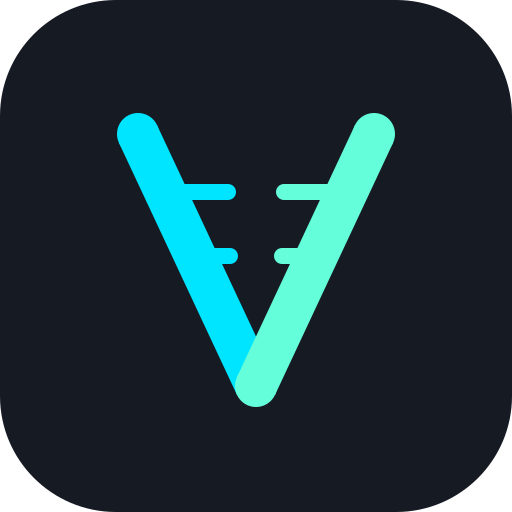

  
    
  <h1>Ardeshir Nahavandi Fard</h1>
  
<strong>Chief Technology Officer (CTO) &amp; Lead Systems Architect</strong>

  
Tehran, Iran

  

    
    
    
    
  

---

### Executive Profile

Adaptive Software Engineer, Systems Architect, and CTO with broad technical leadership experience across high-concurrency cloud services, low-level Linux networking runtimes, event-driven streaming pipelines, serverless edge automation, and machine-first Knowledge Graph governance. 

Proven track record bridging high-throughput backend runtimes (**Go**, **Rust**, **NestJS**, **Kafka**) with containerized orchestration (**Docker**, **Kubernetes**, **ArgoCD**), enterprise bare-metal virtualization (**Proxmox VE HA**), native desktop frameworks (**Wails v3**, **Svelte 5**), cross-platform client systems (**Flutter**, **Dart**), and upstream open-source engine contributions.

---

### Production Impact & Architectural Highlights

| Strategic Domain | Architecture & Technical Stack | Measured Production Impact |
| :--- | :--- | :--- |
| **High-Concurrency Backend Migration** | Golang (Gin, GORM, Fiber v3, FastHTTP, gRPC) | Led core architectural migration from legacy NestJS/Prisma services into Go; enforced `pprof` allocation profiling benchmarks to cut p99 latency by **~40%** and reduce memory overhead by **~35%**. |
| **Autonomous AI Engineering Tooling** | In-house GitLab CI/CD reviewer agent (Cline + self-hosted LLM runtime) | Designed and deployed an autonomous in-house AI code reviewer agent for automated diff inspection and security linting, slashing manual code-review bottlenecks by **~50%**. |
| **Supply-Chain Defense & GitOps** | Harbor, Sonatype Nexus, ArgoCD, Kubernetes, Proxmox VE | Deployed private container registries and caching mirrors (Alpine APK, PyPI, Pub) ensuring 100% deterministic build reproducibility; maintained **99.9% uptime** across HA virtualization clusters. |
| **Real-Time Control Planes & Media** | Pion WebRTC SFU, low-latency WebSockets, Apache Kafka | Architected native WebRTC SFU media pipelines and asynchronous microservice streaming with sub-millisecond route dispatch and automated PII-masked telemetry. |
| **Linux Networking & VPN Infrastructure** | Policy Routing (`ip rule`/`ip route`), nftables, WireGuard, OpenVPN, Xray, PowerDNS | Engineered multi-protocol VPN gateways with automated routing failovers, packet-level diagnostics (`tcpdump`), and authoritative split-horizon recursive DNS. |

---

### Technical Arsenal

#### Languages

[-0175C2?style=flat-square&logo=dart&logoColor=white)](https://dart.dev)

[-F7DF1E?style=flat-square&logo=javascript&logoColor=black)](https://developer.mozilla.org/en-US/docs/Web/JavaScript)
[-A8B9CC?style=flat-square&logo=c&logoColor=black)](https://en.cppreference.com/w/c)

#### Backend, Streaming & Real-Time Runtimes

[-333333?style=flat-square&logo=webrtc&logoColor=white)](https://github.com/pion/webrtc)

[-003B57?style=flat-square&logo=sqlite&logoColor=white)](https://drift.simonbinder.eu)

#### DevOps, Cloud & Observability
[-E57000?style=flat-square&logo=proxmox&logoColor=white)](https://www.proxmox.com)

#### Systems Networking, VPN & Security

#### Desktop, Edge & Client Systems

[-02569B?style=flat-square&logo=flutter&logoColor=white)](https://flutter.dev)

---

### Featured Systems & Open-Source Projects

#### [Gittar](https://github.com/Vonarian/gittar)
**Native macOS Menu Bar Control Panel for GitLab Organizations**  
*Go 1.26 • Wails v3 • Svelte 5 • TypeScript • Tailwind CSS v4*
- Designed and engineered a lightweight native desktop control center for GitLab engineering teams.
- Streams GitLab REST and GraphQL APIs entirely in-memory with sub-10ms query evaluation, providing real-time pipeline compile-state matrices, job failure log inspections, and inbox feeds with zero local filesystem overhead.

#### [Flutter Framework (Upstream Contribution — Merged)](https://github.com/flutter/flutter/pull/186788)
**Upstream Engine & Tooling Native Assets Patch**  
*Dart • C++ Toolchain Config • flutter_tools*
- Authored and merged upstream patch in `flutter_tools` native asset compilation ([flutter/flutter#186788](https://github.com/flutter/flutter/pull/186788)) to correctly enforce Windows native toolchain compilation flags (`mustMatchAppBuild` on Windows native assets).
- Refactored widget preview test states within the framework test harness.

#### [Puro Version Manager](https://github.com/Vonarian/puro)
**Headless CI/CD Optimization for Flutter Environments**  
*Dart • CLI Architecture • CI/CD Caching*
- Contributed to Puro CLI, engineering the `prepare` command to pre-download SDK artifacts and toolchains across headless, containerized CI/CD environments.

#### [WTNews](https://github.com/Vonarian/wtnews)
**3-Tier Failover News Aggregation Pipeline**  
*Dart Backend • Cloudflare Workers (JS) • Edge Automation*
- Engineered a zero-downtime news aggregation pipeline with automated 3-tier fallback logic: falls back seamlessly from the primary Dart backend to a serverless Cloudflare Edge Worker, defaulting to client-side scraping.

#### [Window Watcher](https://github.com/Vonarian/window_watcher)
**Low-Level Win32 API Bridge via Dart FFI**  
*Dart • Foreign Function Interface (FFI) • Win32 C APIs*
- Interfaced Dart directly with native C-based Win32 APIs for OS window manipulation and telemetry.
- Manually manages heap memory lifecycle (`calloc`/`free`) to eliminate native memory leaks in unsafe execution contexts.

#### OpenRGB Client
**Binary Protocol Implementation over Raw TCP Sockets**  
*Dart • Raw TCP Sockets • Binary Protocols*
- Reverse-engineered the OpenRGB hardware synchronization protocol over raw TCP sockets.
- Packed and unpacked low-level binary payloads (`ByteData`/`Uint8List`) in accordance with strict network protocol specifications.

#### [Aether](https://github.com/Vonarian/Aether)
**Resilient Asynchronous Network Tunneling Daemon**  
*Rust • Async Networking • Failover Protocols*
- Low-latency async networking daemon built in Rust with automated tunnel health monitoring, configurable reconnection thresholds, and failover triggers.

#### [Gramercy](https://github.com/Vonarian/gramercy)
**Non-Destructive Localization Editor & Delta Patching**  
*JavaScript • Delta Patching Algorithms*
- Localization engine for War Thunder featuring update-proof non-destructive delta patching algorithms.

---

### Professional Trajectory

- **Chief Technology Officer (CTO) & Lead Systems Architect** — **PetaProc** *(Aug 2025 – Present)*  
  Directing company-wide engineering strategy, microservices migration to Go, machine-first Knowledge Graph governance, autonomous CI/CD AI reviewer pipelines, enterprise identity, and supply-chain artifact caching.
- **Technical Moderator & QA Analyst** — **Gaijin Entertainment** *(2023 – Present)*  
  Triaging client-server synchronization, network handshakes, and platform defects across distributed game communities (War Thunder, Age of Water) utilizing YouTrack and CBR.
- **Creator & Lead Systems Architect** — **Gittar** *(2024 – Present)*  
  Architecting open-source developer tooling and native macOS control centers.
- **Full-Stack Software & DevOps Engineer** — **Self-Employed / Freelance** *(2021 – Aug 2025)*  
  Provisioning high-availability bare-metal Proxmox VE clusters, Linux policy routing firewalls, Kerio mail/VPN infrastructure, and production Flutter applications.

---

### Telemetry & Activity

  
  

